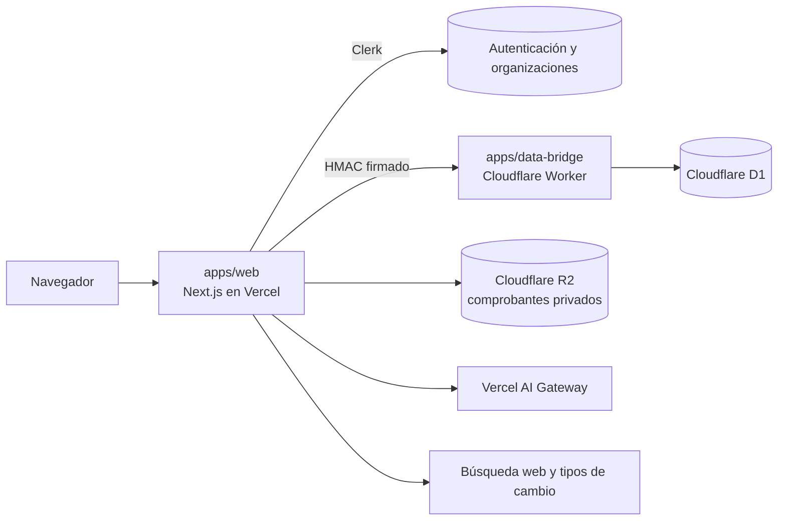

# Cozte

**Costos claros y un asistente que los entiende, para pequeñas empresas que producen.**

Cozte es una aplicación web para PyMEs manufactureras y emprendimientos que fabrican lo que venden: alimentos, cosmética, gráfica, carpintería, artesanías. Calcula cuánto cuesta producir cada producto, cuánto deja cada venta y cuánto hay que vender para no perder, y lo mantiene al día a medida que cambian los precios, las ventas y los gastos.

Tiene dos formas de trabajar sobre los mismos datos:

- **Cozte AI**, un asistente conversacional que carga la información, responde preguntas sobre el negocio y explica los números al nivel de cada persona.
- **Un panel clásico** para la operación diaria: caja de ventas, cobros, compras, entregas, clientes y proveedores.

La interfaz y el asistente están en español y pensados para Latinoamérica: 18 monedas, tipos de cambio por fecha y el trato de cada país (vos o tú).

> Producto en etapa piloto. Ver [Alcance y límites](#alcance-y-límites).

---

## Contenido

- [Qué resuelve](#qué-resuelve)
- [Funcionalidades](#funcionalidades)
- [Cómo está hecho](#cómo-está-hecho)
- [Estructura del repositorio](#estructura-del-repositorio)
- [Desarrollo local](#desarrollo-local)
- [Pruebas](#pruebas)
- [Despliegue](#despliegue)
- [Alcance y límites](#alcance-y-límites)
- [Seguridad](#seguridad)
- [Licencia](#licencia)

## Qué resuelve

Una pequeña empresa que fabrica varios productos suele tener los costos repartidos entre facturas, una planilla desactualizada y la memoria de quien compra. Comparte insumos y gastos entre productos (la luz, el alquiler, el sueldo del taller) y no sabe cuánto le cuesta realmente cada unidad, ni si un canal de venta con comisión le conviene.

Cozte ordena esa información en un modelo de costos explícito y verificable:

- un precio de insumo se carga una vez y recalcula todos los productos que lo usan;
- cada gasto compartido se reparte con un criterio a la vista (horas, unidades o porcentajes);
- cada número muestra de dónde sale, qué supuestos usa y qué dato falta para que sea confiable.

## Funcionalidades

### Costos

- **Costos de producción.** Productos, recetas, insumos con precio versionado y fuente, mano de obra por lote y gastos del taller. Cada costo se clasifica en fijo, variable o mixto. Tiene vistas de tabla, lista y tablero, con edición en contexto y revisión del impacto antes de confirmar cambios.
- **Gastos de la empresa.** Gastos mensuales por área (producción, entrega, ventas, administración), equivalencia mensual de pagos trimestrales o anuales, e inversiones depreciadas en su vida útil.
- **Punto de equilibrio.** Cuántas unidades y cuánto dinero vender de cada producto para cubrir los costos fijos, según la mezcla de ventas elegida, y también para alcanzar una meta de ganancia.
- **Historial.** Una foto inmutable del costo de cada producto en cada cambio confirmado, con la explicación de qué lo movió.

### Día a día

- **Ventas.**
  - Una caja para registrar una venta en segundos: productos en botones con el precio del canal, cliente, medio de pago o «queda debiendo», y atajos de teclado.
  - Una lista por día, semana o mes, filtrable por lo pendiente de cobrar o de entregar.
  - Acciones en grupo: cobrar, entregar, cambiar de canal o anular varias ventas a la vez.
- **Cobros.** Lo cobrado, lo que cada cliente debe y el medio de pago de cada venta.
- **Clientes.** Ficha con historial y estado (nuevo, frecuente, en riesgo). Cada cliente puede tener un canal habitual, un descuento general y precios acordados por producto, que se aplican solos al venderle.
- **Canales.** Comisiones, costo de entrega y ajuste de precio de cada canal, cuánto vendió cada uno y cuánto queda por unidad en cada canal.
- **Compras.** Compras de insumos, gastos e inversiones, con comprobante y proveedor. Al comprar un insumo se propone su proveedor habitual y se muestra el último precio que cobró.
- **Proveedores.** Lo que vende cada proveedor y cómo cambiaron sus precios.
- **Entregas.** Zonas de reparto con días y costos, hoja de ruta del día con enlace a Google Maps y envío por WhatsApp.
- **Resultado del mes.** Ventas, costo variable, gastos fijos y resultado, con lecciones a partir de los propios números.
- En todos los casos, el cliente o el proveedor se elige de la lista o se crea en el momento, nunca como texto libre.

### Cozte AI

- **Conversación con herramientas reales.** Registra productos, recetas, compras, ventas, cobros y entregas; calcula, simula escenarios y arma gráficos y presentaciones.
- **Archivos adjuntos.** Lee imágenes, PDF y Excel, como la foto de un remito o una lista de precios.
- **Nivel de explicación.** Simple, Medio o Avanzado, elegido por cada persona.
- **Recorrido de descubrimiento.** Guía por etapas: qué se produce, los insumos, dónde se produce, cómo se vende y cómo se entrega. Tiene dos modos:
  - **Proyecto:** evaluar una idea con estimaciones antes de invertir.
  - **En marcha:** ordenar un negocio que ya vende.

  Las etapas se configuran sin desplegar código y habilitan secciones a medida que se completan.
- **Precios de mercado.** Búsqueda de precios actuales en la web, siempre con página y fecha. Cada precio puede quedar fijo, seguir al mercado (se actualiza solo cada mes) o servir solo de referencia.
- **Presentaciones.** Informes listos para compartir con un enlace público.

### Multimoneda y país

- Registra 18 monedas: las que no usan centavos (CLP, ARS, COP, PYG, CRC, UYU, DOP) en unidades enteras, y USD, EUR, BRL, MXN, PEN y otras con centavos.
- Las compras en moneda extranjera se convierten al tipo de cambio de su fecha.
- La fecha y la hora se calculan en la zona horaria de la empresa.

## Cómo está hecho



| Capa | Tecnología | Función |
| --- | --- | --- |
| Aplicación y API | Next.js 16, React 19, Tailwind CSS 4, en Vercel | Interfaz, rutas de API, cron y el agente |
| Autenticación | Clerk | Sesiones y organizaciones: cada empresa es una organización |
| Datos | Cloudflare D1, a través de un Worker propio | Empresas, costos, ventas, compras, clientes, auditoría |
| Archivos | Cloudflare R2 | Comprobantes privados por empresa |
| Agente | AI SDK 7 y Workflow (ejecución durable), Vercel AI Gateway | Cozte AI con herramientas, modelo configurable |

### Principios de diseño

- **Un motor de costos determinístico.** Toda la aritmética financiera ocurre en código puro y probado (`apps/web/lib`), no en el modelo de lenguaje. El costo por unidad es (insumos del lote + mano de obra del lote + la parte del lote en los gastos compartidos del mes) ÷ unidades buenas del lote. Un costo al que le falta un dato queda marcado como *estimado* o *incompleto*, con el supuesto a la vista.
- **El agente solo afirma lo que hizo.** Cada respuesta de Cozte pasa por un verificador determinístico (`lib/cozte-response-verifier.ts`) antes de mostrarse. Lo contrasta con los recibos de las herramientas del turno: cambios que no se guardaron, cifras que no salieron de un cálculo, preguntas o listas anunciadas que no aparecen. La respuesta que no pasa se corrige o se reemplaza por una armada solo con esos recibos. Una segunda revisión evalúa si la respuesta sirve a la persona.
- **Registros que no se mueven solos.** Una venta fija el precio cobrado y el costo de cada producto del día en que se hizo. Corregir un costo después no reescribe el pasado, y cada cambio queda en la auditoría.
- **Idempotencia y concurrencia.** Las escrituras llevan clave de idempotencia y control de revisión, así que un reintento del agente o de la red no duplica datos.

<details>
<summary><strong>Reglas contables del motor</strong></summary>

- **Precisión por moneda.** El motor calcula en la unidad mínima de cada moneda para que los repartos cuadren exactos. Los precios de insumos conservan sus milésimas hasta multiplicarse por el consumo del lote.
- **Costeo variable.** El resultado del mes descuenta los insumos y la mano de obra de lo vendido, con el costo del día de cada venta. Una venta cargada con retraso usa la foto de costo de esa fecha. Los gastos del taller cuentan como gastos fijos del mes.
- **Comportamiento de cada gasto.** Fijo, variable (crece con cada unidad, tanda u hora de producción) o mixto. La parte variable pasa al costo de cada unidad; la fija se cubre en el punto de equilibrio.
- **Gastos por período.** Cada mes usa los gastos vigentes en ese mes. Al iniciar un período nuevo, los gastos continúan con sus montos y el anterior queda en el historial.
- **Inversiones.** Se deprecian en línea recta durante su vida útil, y las cuotas suman exactamente el precio. Pueden sumarse al costo de cada producto o contar solo en el resultado del mes.
- **Compras en otra moneda.** Se convierten al tipo de cambio de su fecha o al de la factura. Los insumos comprados son caja, no gasto del mes.
- **Entregas.** Una entrega cancelada no tiene costo.
- **Cobros.** Una venta queda cobrada salvo que se registre lo contrario. Una venta cobrada sigue cobrada si se corrige su total.

</details>

## Estructura del repositorio

La documentación técnica de la aplicación (módulos, tablas, herramientas de Cozte y decisiones de diseño) está en [`apps/web/README.md`](apps/web/README.md).

```
apps/
  web/                    Aplicación Next.js
    app/                  Rutas: landing, /demo, /app (espacio de trabajo), /api
    components/           Interfaz (secciones del negocio, chat de Cozte, gráficos)
    lib/                  Motor de costos y reglas de negocio, puro y probado
    lib/server/           Acceso a datos, herramientas y workflow de Cozte, integraciones
  data-bridge/            Cloudflare Worker que ejecuta consultas D1 firmadas
    migrations/           Migraciones SQL de D1, en orden
PLAN_IMPLEMENTACION_MVP.md  Plan de producto, hipótesis y evolución
MOCKUPS_UX_MVP.html         Exploración de UX inicial
```

## Desarrollo local

Requisitos: Node.js 22 o superior, npm y una cuenta de Clerk con Organizations habilitado. Para el chat de Cozte hace falta además una clave del Vercel AI Gateway.

```bash
# 1. Dependencias
cd apps/data-bridge && npm ci
cd ../web && npm ci

# 2. Base de datos local y el Worker
cd ../data-bridge
cp .dev.vars.example .dev.vars        # DATA_BRIDGE_SECRET de 32 caracteres o más
npm run db:local
npm run dev

# 3. Aplicación web
cd ../web
cp .env.example .env.local            # Clerk, DATA_BRIDGE_URL y el mismo secreto
npm run dev
```

- `/` es la landing pública.
- `/demo` es una empresa de ejemplo que funciona completa en el navegador, sin base de datos ni cuenta.
- `/app` es el espacio de trabajo real y requiere iniciar sesión.

### Variables de entorno (`apps/web`)

| Variable | Uso |
| --- | --- |
| `NEXT_PUBLIC_CLERK_PUBLISHABLE_KEY`, `CLERK_SECRET_KEY` | Autenticación |
| `DATA_BRIDGE_URL`, `DATA_BRIDGE_SECRET` | Conexión firmada con el Worker de datos (solo servidor) |
| `AI_GATEWAY_API_KEY` | Cozte AI |
| `COZTE_MODEL`, `COZTE_FALLBACK_MODELS`, `COZTE_THINKING_BUDGET` | Modelo del agente y modelos de respaldo (opcional) |
| `COZTE_QUALITY`, `COZTE_QUALITY_MODEL`, `COZTE_QUALITY_MAX_MS` | Revisión de calidad de cada respuesta (opcional) |
| `R2_ACCOUNT_ID`, `R2_BUCKET`, `R2_ACCESS_KEY_ID`, `R2_SECRET_ACCESS_KEY` | Comprobantes en R2 |
| `CRON_SECRET` | Autoriza las tareas programadas |
| `FIRECRAWL_API_KEY`, `COZTE_WEB_SEARCH_MONTHLY_LIMIT`, `COZTE_MARKET_CHANGE_TO_CONFIRM` | Precios desde la web (opcional) |
| `FXRATES_API_KEY` | Cuota propia de tipos de cambio (opcional) |

Ninguna clave va en el código: todas viven en `.env.local` en desarrollo y en las variables del proyecto en producción.

## Pruebas

```bash
cd apps/web
npm run typecheck && npm run lint && npm run test
```

- **Unitarias** (Vitest): el motor de costos, las reglas contables, el verificador del agente y la lógica de cada sección. Son más de 300 pruebas.
- **Integración contra D1**: los archivos `*.integration.test.ts` corren contra el Worker local. Para correrlas, levanta `wrangler dev` y define `COZTE_BRIDGE_TEST_URL`.
- **Evaluaciones del agente**: `lib/server/cozte-agent.eval.test.ts` conversa con el modelo real sobre escenarios del negocio (registrar una venta debida, guardar un acuerdo de precios, buscar precios en la web, completar una receta). Mide si Cozte hizo lo correcto y si su respuesta pasó el verificador. Requieren `AI_GATEWAY_API_KEY` y el Worker local.
- **Prueba visual**: `npm run smoke` recorre la aplicación con Playwright.

En `apps/data-bridge`: `npm run typecheck`, `npm run deploy:dry` y `npm run smoke`.

## Despliegue

1. **Cloudflare.** Crear la base D1 y un bucket R2 privado. Desplegar el Worker de `apps/data-bridge` con `DATA_BRIDGE_SECRET` como secreto y aplicar las migraciones con `npm run db:remote`.
2. **Vercel.** Importar el repositorio con Root Directory `apps/web` y cargar las variables de entorno. Las tareas programadas están en `apps/web/vercel.json`:
   - revisión diaria de insumos sin precio;
   - actualización mensual de los precios de mercado vencidos;
   - tipos de cambio cada hora.
3. **Orden.** Cuando una versión trae migraciones nuevas, se aplican antes de desplegar la web.

## Alcance y límites

Cozte está en etapa piloto. Hoy **no** incluye:

- reglas fiscales, facturación electrónica ni conciliación bancaria;
- importación masiva de facturas (Cozte lee un comprobante adjunto en el chat y lo registra, de a uno);
- integraciones directas con plataformas de venta o proveedores;
- costeo real por lote cargado aparte del estimado, cuentas separadas de pérdidas extraordinarias ni capacidad ociosa.

Los resultados de Cozte ayudan a decidir, pero no reemplazan la contabilidad ni el asesoramiento profesional.

## Seguridad

- Cada empresa es una organización de Clerk, y todas las consultas se filtran por organización en el servidor.
- La base de datos no es accesible desde el navegador: la aplicación llama a un Worker propio con solicitudes firmadas (HMAC), que solo ejecuta consultas.
- Los comprobantes se guardan en un bucket privado y se sirven con enlaces temporales.
- Lo que el agente lee de páginas web, archivos o datos cargados se trata como dato, nunca como instrucción.

Si encuentras una vulnerabilidad, repórtala de forma privada desde la pestaña **Security** del repositorio en lugar de abrir un issue público.

## Licencia

Distribuido bajo la [licencia MIT](LICENSE).
